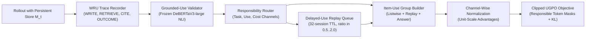

# Credit Follows Use: Use-Grouped Policy Optimization for Long-Context Memory Agent

Official PyTorch implementation of **Use-Grouped Policy Optimization (UGPO)**, a group-relative reinforcement learning framework for long-context external-memory agents.

## Overview

Optimizing learned memory controllers (`ADD`, `UPDATE`, `DELETE`, `NOOP`) over long document streams and multi-session interactions poses a severe long-horizon credit-assignment problem: a memory write occurs early in an episode, while its downstream utility is only observed when a distant request retrieves and grounds that item.

UGPO exploits an observable signal intrinsic to persistent external memory services—each materialized item follows a traceable **Write–Retrieve–Use (WRU)** lifecycle:

1. **WRU Trace Instrumentation (`src/ugpo/trace/`):** Assigns every materialized item a stable identifier $i$, tracks predecessor lineage $\ell$ across updates and deletes, and records $e = (\text{type}, i, t, q, p, \ell)$ outside the model context with $O(E + K)$ bookkeeping complexity.
2. **Grounded-Use Detection (`src/ugpo/trace/grounding.py`):** Distinguishes genuine consumption from passive retrieval exposure via a three-way conjunction $u_{q,i} = \mathbb{I}[i \in S_q]\,\mathbb{I}[i \in C_q]\,\mathbb{I}[g(m_i, y_q) = 1]$ scored by a frozen `cross-encoder/nli-deberta-v3-large` verifier (threshold `0.8`, calibrated on MultiNLI), plus the action-grounded variant $u^{\text{env}}_{t,i}$ for ALFWorld and WebShop.
3. **Responsibility Routing (`src/ugpo/credit/routing.py`):** Routes task, use, and cost credit strictly to responsible lifecycle operations via masks $(z_i^{\text{write}}, z_i^{\text{use}}, z_{q,i}^{\text{ret}}, z_q^{\text{ans}})$—protecting grounded writes from downstream answer-generation failures while charging unsupported citations on the use channel.
4. **Item-Use Grouping (`src/ugpo/credit/grouping.py`):** Avoids the exponential coverage decay $\mathbb{E}[C_{\text{state}}(\mathcal{B}, n)] \le \min\{1, (|\mathcal{B}| - 1)\gamma^n\}$ of exact-store keys by constructing listwise retrieval groups and cross-request replay groups under frozen pre-action keys $\kappa(e) = (\text{type}(e), \phi(i), \psi(q), \Delta(i, q))$.
5. **Channel-Wise Normalization & Delayed-Use Replay (`src/ugpo/credit/normalization.py`, `replay.py`):** Normalizes task, use, and cost channels independently before linear aggregation $(\alpha_{\text{task}}, \alpha_{\text{use}}, \alpha_{\text{cost}}) = (0.60, 0.25, 0.15)$ and propagates cross-session credit to originating writes using stored behavior-policy log-probabilities without re-executing intervening history (`1.0x` environment rollout multiplier).



## Architecture & Paper Mapping

| Paper Component | Reference | Implementation |
| :--- | :--- | :--- |
| Memory transition $\mathcal{M}_t = F(\mathcal{M}_{t-1}, o_t, v_t)$ | Section 2, Eq. 1 | [`MemoryStore`](src/ugpo/memory/store.py) |
| Exact-state coverage $C_{\text{state}}(\mathcal{B})$ & decay bound | Section 2, Eq. 3–4 | [`compute_exact_state_coverage`](src/ugpo/credit/grouping.py) |
| WRU event tuple $e = (\text{type}, i, t, q, p, \ell)$ | Section 3.1, Eq. 5 | [`WRUEvent`](src/ugpo/trace/schema.py), [`WRUTraceRecorder`](src/ugpo/trace/recorder.py) |
| Grounded-use indicator $u_{q,i}$ & $u^{\text{env}}_{t,i}$ | Section 3.1, Eq. 6; App. H, Eq. 19 | [`GroundedUseValidator`](src/ugpo/trace/grounding.py) |
| Responsibility masks $(z^{\text{write}}, z^{\text{use}}, z^{\text{ret}}, z^{\text{ans}})$ | Section 3.2, Eq. 7 | [`ResponsibilityRouter`](src/ugpo/credit/routing.py) |
| Frozen item-use key $\kappa(e) = (\text{type}, \phi(i), \psi(q), \Delta(i, q))$ | Section 3.3, Eq. 8 | [`FrozenGroupingMaps`](src/ugpo/credit/grouping.py), [`ItemUseGroupBuilder`](src/ugpo/credit/grouping.py) |
| Multi-channel rewards $R^{\text{task}}, R^{\text{use}}, R^{\text{cost}}$ | Section 3.4, Eq. 10–11 | [`ResponsibilityRouter.route_trace`](src/ugpo/credit/routing.py) |
| Channel-wise normalization & Proposition 1 | Section 3.3–3.4, Eq. 9, 12, 18 | [`normalize_and_combine_advantages`](src/ugpo/credit/normalization.py) |
| Delayed-use replay queue $\mathcal{Q}_{\text{delay}}$ | Section 3.4; App. E | [`DelayedUseReplayQueue`](src/ugpo/credit/replay.py) |
| Clipped UGPO objective $\mathcal{L}_{\text{UGPO}}(\theta)$ | Section 3.4, Eq. 13–14 | [`compute_ugpo_loss`](src/ugpo/policy/loss.py) |
| Full training loop (`TRAININGSTEP`) | Appendix D, Algorithm 1 | [`UGPOTrainer`](src/ugpo/policy/trainer.py) |
| Post-hoc controlled provenance $P_q$ & bootstrap CI | Appendix H & I.8 | [`evaluate_controlled_provenance`](src/ugpo/eval/provenance.py), [`hierarchical_paired_bootstrap`](src/ugpo/eval/significance.py) |

## Repository Structure

```text
credit/
├── configs/
│   ├── ugpo_qwen25_7b.yaml         # Primary matched configuration (Table 5)
│   ├── ugpo_qwen25_14b.yaml        # Scaling configuration (Table 2)
│   ├── ugpo_qwen25_32b.yaml        # Scaling configuration (Table 2)
│   ├── agentic_transfer.yaml       # ALFWorld & WebShop ReAct configuration (Table 9)
│   └── ablations.yaml              # Component ablation & baseline operator presets (Tables 3 & 14)
├── data/
│   ├── README.md                   # Dataset schemas and provenance protocol
│   ├── hotpotqa/
│   │   └── hotpot_dev_distractor.parquet  # Official HotpotQA distractor dev set (7,405 examples)
│   └── locomo/
│       └── locomo10.json                  # Official LoCoMo benchmark (10 dialogues, 1,986 QAs)
├── scripts/
│   ├── fit_grouping_maps.py        # Fit and freeze pre-write E5 clusters and difficulty strata
│   ├── train_ugpo.py               # Train UGPO, baselines, and component ablations
│   └── evaluate.py                 # Evaluate task scores, lifecycle metrics, and provenance
├── src/ugpo/
│   ├── config.py                   # Configuration dataclasses
│   ├── memory/                     # Persistent store M_t and E5-large dense retriever
│   ├── trace/                      # WRU trace schema, recorder, and NLI grounding validator
│   ├── credit/                     # Responsibility routing, grouping, normalization, replay
│   ├── policy/                     # Qwen2.5 memory agent, clipped loss, Algorithm 1 trainer
│   ├── data/                       # Streaming episode schema and benchmark loaders
│   └── eval/                       # Task metrics, Table 6 lifecycle metrics, P_q, bootstrap CI
└── tests/                          # Unit and end-to-end verification suite
```

## Installation

Python 3.10+ and PyTorch 2.2+ are required.

```bash
git clone https://github.com/Ruinan-Li/credit.git
cd credit
pip install -r requirements.txt
pip install -e .
```

## Bundled Datasets

Two complete official benchmarks are included directly under [`data/`](data/README.md):

- **HotpotQA** (`data/hotpotqa/hotpot_dev_distractor.parquet`): 7,405 multi-hop QA examples formatted as sequential document streams with `supporting_facts` offsets for post-hoc controlled provenance $P_q$.
- **LoCoMo** (`data/locomo/locomo10.json`): 10 long-horizon multi-session dialogues with 1,986 QA pairs across all 5 official categories and `evidence` dialogue turn IDs (`dia_id`).

Additional benchmarks supported by [`src/ugpo/data/loaders.py`](src/ugpo/data/loaders.py) include **2WikiMultiHopQA**, **LongMemEval**, **ALFWorld**, and **WebShop**.

## Usage

### 1. Fit and Freeze Pre-Action Grouping Maps

Grouping maps ($\phi(i)$ from 8 pre-write `intfloat/e5-large-v2` source clusters and $\psi(q)$ context/difficulty strata) are fitted once before optimization and frozen:

```bash
python scripts/fit_grouping_maps.py \
  --config configs/ugpo_qwen25_7b.yaml \
  --benchmark hotpotqa \
  --data-path data/hotpotqa/hotpot_dev_distractor.parquet \
  --output-dir outputs/frozen_grouping_maps
```

Pass `--compute-ref-entropy` to populate reference-policy greedy next-token entropy quintiles using the frozen initial policy $\pi_{\text{ref}}$.

### 2. Train UGPO (Algorithm 1)

```bash
# Streaming long-document multi-hop QA (HotpotQA)
python scripts/train_ugpo.py \
  --config configs/ugpo_qwen25_7b.yaml \
  --benchmark hotpotqa \
  --data-path data/hotpotqa/hotpot_dev_distractor.parquet \
  --grouping-maps-dir outputs/frozen_grouping_maps \
  --output-dir outputs/ugpo_hotpotqa

# Multi-session conversational memory (LoCoMo)
python scripts/train_ugpo.py \
  --config configs/ugpo_qwen25_7b.yaml \
  --benchmark locomo \
  --data-path data/locomo/locomo10.json \
  --output-dir outputs/ugpo_locomo
```

### 3. Run Component Ablations and Assignment Operators

Every row in Tables 3 and 14 is exposed through [`configs/ablations.yaml`](configs/ablations.yaml):

```bash
# Outcome-only GRPO baseline
python scripts/train_ugpo.py --config configs/ugpo_qwen25_7b.yaml --preset outcome_grpo --benchmark hotpotqa --data-path data/hotpotqa/hotpot_dev_distractor.parquet

# Exact-state grouping (w/o Item-use groups)
python scripts/train_ugpo.py --config configs/ugpo_qwen25_7b.yaml --preset wo_item_use_groups --benchmark hotpotqa --data-path data/hotpotqa/hotpot_dev_distractor.parquet

# Joint normalization ablation (w/o Channel-wise norm.)
python scripts/train_ugpo.py --config configs/ugpo_qwen25_7b.yaml --preset wo_channel_wise_norm --benchmark hotpotqa --data-path data/hotpotqa/hotpot_dev_distractor.parquet
```

Available presets: `ugpo`, `wo_grounded_use`, `wo_grounding_check`, `wo_channel_wise_norm`, `wo_responsibility_routing`, `wo_delayed_use_replay`, `wo_item_use_groups`, `wo_use_channel`, `wo_cost_channel`, `wo_replay_groups`, `wo_listwise_groups`, `outcome_grpo`, `write_local_contrast`, `token_overlap_verifier`.

### 4. Evaluate Task, Lifecycle, and Provenance Metrics

```bash
python scripts/evaluate.py \
  --config configs/ugpo_qwen25_7b.yaml \
  --checkpoint outputs/ugpo_locomo/final_checkpoint \
  --benchmark locomo \
  --data-path data/locomo/locomo10.json \
  --output-json outputs/eval_locomo.json
```

### 5. Run Verification Tests

```bash
pytest -v
```

## Matched Experimental Settings (Table 5)

| Component | Setting |
| :--- | :--- |
| Policy backbone | `Qwen/Qwen2.5-7B-Instruct` (128K context; also 14B / 32B) |
| Memory interface | `ADD`, `UPDATE`, `DELETE`, `NOOP` with stable item identifiers |
| Memory / retrieval budget | 8K retained tokens; top-8 retrieved items per request |
| Optimization | AdamW, learning rate $1\times 10^{-6}$, 500 updates |
| Sampling | 8 rollouts per input, effective batch size 64, 5 seeds |
| Policy regularization | $\delta_{\text{clip}} = 0.2$, $\beta = 0.01$ |
| Advantage channel weights | $(\alpha_{\text{task}}, \alpha_{\text{use}}, \alpha_{\text{cost}}) = (0.60, 0.25, 0.15)$ |
| Cost & spam weights | $\lambda_{\text{spam}} = 0.5$, $\lambda_{\text{store}} = 10^{-5}$, $\lambda_{\text{ret}} = 0.02$, $\lambda_{\text{ctx}} = 10^{-5}$ |
| Grounding verifier | `cross-encoder/nli-deberta-v3-large`, support threshold `0.8` |
| Item buckets | Source domain + 8 frozen pre-write clusters from `intfloat/e5-large-v2` |
| Delay / replay | 5 logarithmic bins; 1:1 current/replay; age cutoff 32 sessions; ratio cutoff $[0.5, 2.0]$ |

## Summary of Main Results (Table 1, Qwen2.5-7B-Instruct)

| Method | HotpotQA (F1) | 2Wiki (F1) | LoCoMo | LongMemEval | Average |
| :--- | :---: | :---: | :---: | :---: | :---: |
| Outcome GRPO | 68.4 ± 0.7 | 65.0 ± 0.8 | 55.7 ± 0.9 | 62.8 ± 0.7 | 63.0 ± 0.8 |
| GiGPO | 69.1 ± 0.6 | 65.8 ± 0.7 | 56.5 ± 0.8 | 63.6 ± 0.6 | 63.8 ± 0.7 |
| ReMemR1 | 71.3 ± 0.4 | 68.1 ± 0.5 | 58.6 ± 0.7 | 65.1 ± 0.5 | 65.8 ± 0.5 |
| Memory-R1 | 69.8 ± 0.6 | 66.7 ± 0.6 | 59.4 ± 0.7 | 67.1 ± 0.6 | 65.8 ± 0.6 |
| Fine-Mem | 71.8 ± 0.5 | 68.6 ± 0.5 | 60.1 ± 0.6 | 66.4 ± 0.5 | 66.7 ± 0.5 |
| Mem-T | 72.1 ± 0.5 | 68.9 ± 0.5 | 60.5 ± 0.6 | 66.8 ± 0.5 | 67.1 ± 0.5 |
| Memory-R2 | 72.4 ± 0.4 | 69.3 ± 0.5 | 61.0 ± 0.5 | 67.3 ± 0.5 | 67.5 ± 0.5 |
| HiMPO | 72.7 ± 0.4 | 69.5 ± 0.4 | 61.1 ± 0.5 | 67.5 ± 0.5 | 67.7 ± 0.5 |
| Retrieve-gated (Control) | 71.0 ± 0.5 | 67.7 ± 0.5 | 59.2 ± 0.6 | 66.4 ± 0.5 | 66.1 ± 0.5 |
| **UGPO (Ours)** | **73.6 ± 0.3** | **70.2 ± 0.4** | **61.8 ± 0.5** | **68.7 ± 0.4** | **68.6 ± 0.4** |

## Citation

If you find this repository useful in your research, please cite:

```bibtex
@inproceedings{ugpo2027credit,
  title     = {Credit Follows Use: Use-Grouped Policy Optimization for Long-Context Memory Agent},
  author    = {Anonymous Authors},
  booktitle = {International Conference on Learning Representations (ICLR)},
  year      = {2027}
}
```

## License

This project is released under the [MIT License](LICENSE).